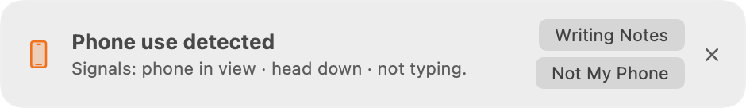
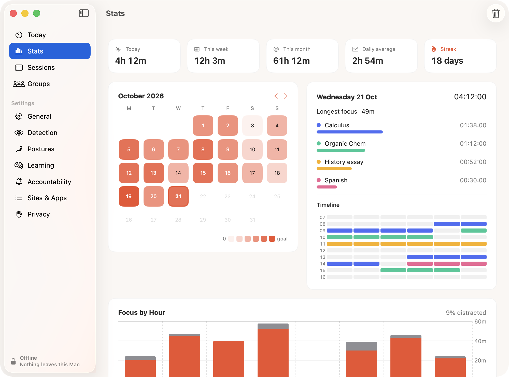
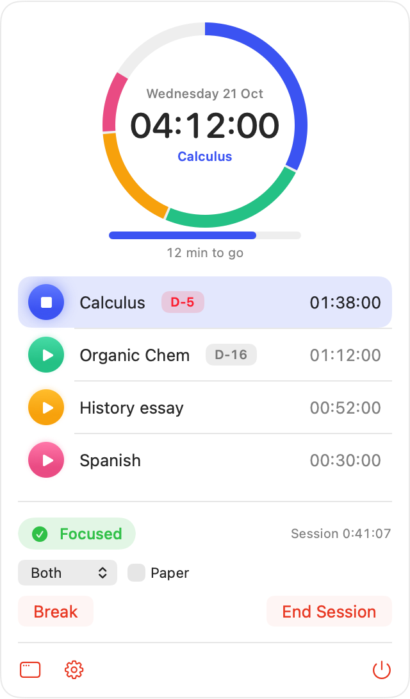

# Clocked

A study timer for the Mac that only counts the time you're actually studying. Pick up your phone, open YouTube or walk away, and the clock stops.

I made it because I'd "study" for four hours and get about two hours of work done. The rest went to my phone under the desk.


## Download

Get the `.dmg` from the [website](https://snakeluck360gt.github.io/clocked/) and drag Clocked into Applications. It needs macOS 26 on Apple Silicon.

The app isn't notarized yet, so the first time you open it go to System Settings → Privacy & Security and click Open Anyway.

## How it works

- The camera and mic look for phone use: head down, no typing, sound not from your Mac.
- The app and browser tab you're on are checked against your subject.
- More than 5 seconds out of view counts as away.
- When you're distracted, the clock pauses and a banner appears.
- The banner buttons correct mistakes, and a small [neural network](docs/neural-network.md) learns from them.



## Privacy

- The camera and mic only run during a session. Nothing is recorded.
- The app has no internet access. Check with `codesign -d --entitlements - /Applications/Clocked.app`.
- Study groups are optional and end-to-end encrypted.

<p>
  
  
</p>

## Building it

You need macOS 26 on Apple Silicon and the Xcode Command Line Tools.

```bash
./build.sh        # builds build/Clocked.app
./build.sh dmg    # also makes a .dmg
Tests/run.sh      # runs the tests
```

Study groups need a Supabase project in `supabase.env` (see `supabase.env.example`). Everything else works without it.

More detail is in [docs/how-it-works.md](docs/how-it-works.md).
