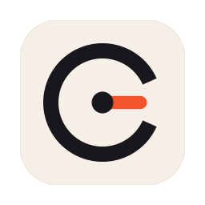
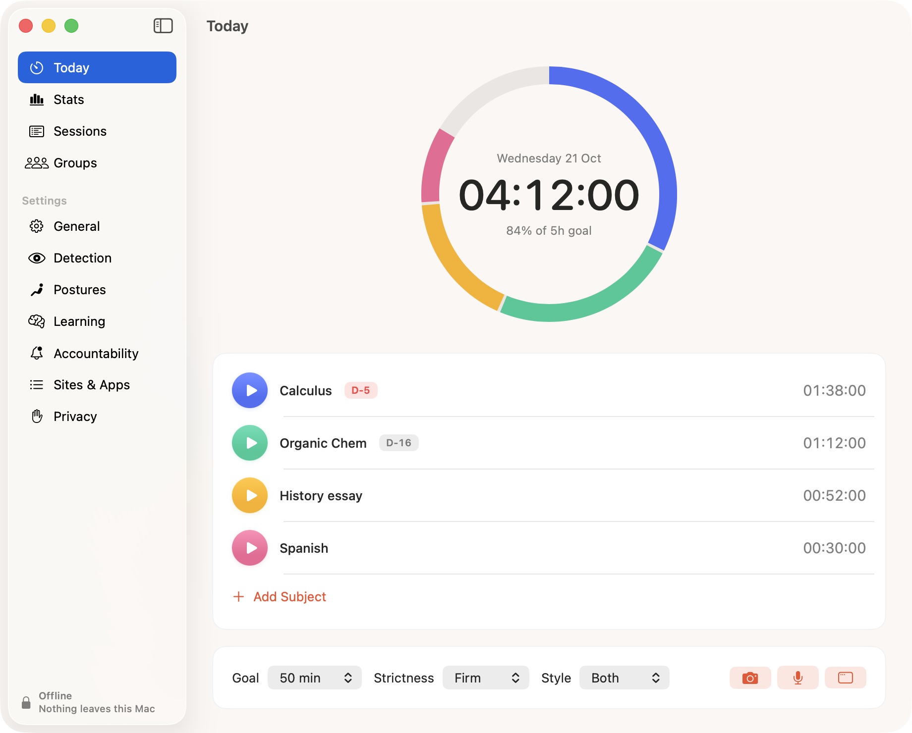

# Clocked

I made Clocked because I'd sit at my desk for four hours, call it a study session, and get maybe two hours of real work done. The rest went to my phone, under the desk, where no timer could see it.

Clocked is a study timer for the Mac that only counts the time you're actually working. You pick a subject and press play. If you pick up your phone, wander off to YouTube or leave your desk, the clock stops, and it keeps bugging you until you come back.

If you've used YPT (Yeolpumta), it's the same idea, except the app is the one keeping you honest instead of you.



## Download

Get the `.dmg` from the [website](https://snakeluck360gt.github.io/clocked/), open it and drag Clocked into Applications.

You need a Mac with Apple Silicon running macOS 26.

I don't have an Apple Developer account yet, so the app isn't notarized and macOS will refuse to open it the first time. Go to System Settings → Privacy & Security, scroll down and click Open Anyway. You only have to do that once.

## How it catches you

Your phone is the hard part, because it's usually in your lap where the camera can't see it. So Clocked mostly doesn't look for the phone. It looks at you.

Every second it adds up small hints: your head is lower than your usual screen posture, you haven't typed or touched the mouse in a while, there's talking or music that isn't coming from your Mac, the audio has that choppy short-video rhythm, you're smiling at something. One hint on its own never does anything. A few together do. Scrolling with the sound off gets caught in about 12 seconds, and with sound in about 6.

It also checks which app and browser tab you're on every few seconds, and asks Apple Intelligence (on your Mac, not online) whether it fits what you said you're studying. If you're out of the camera's view for more than 5 seconds, you're marked away.

When it decides you're off task, the clock pauses and a small banner shows up. Depending on how strict you set it, that can turn into a full-screen "Phone down" screen, an iMessage to your own iPhone so it buzzes in your hand, or Clocked closing the tab for you.

It does get things wrong sometimes. Writing on paper looks a lot like looking at a phone. The banner has buttons for that ("Writing notes", "Not my phone"), and a small neural network on your Mac learns from them so it's wrong less often. Recording your postures takes about a minute and helps a lot.

Music is fine. Steady music never counts against you, with or without vocals.

## Privacy

This is the part I cared about most, since it's an app that turns on your camera and microphone.

- The camera and mic only run during a session (or a test you start). Never in the background.
- Nothing is recorded. Frames and audio are analysed in memory and thrown away.
- The main app isn't allowed on the internet at all. That's enforced by the macOS sandbox, not just a promise. Run `codesign -d --entitlements - /Applications/Clocked.app` and you'll see there's no `network.client`.
- Almost nothing is saved: your settings, daily totals per subject, and a few numbers describing your postures. No images, audio, keystrokes or page titles.
- Settings → Privacy → Delete All My Data wipes all of it.

## Study groups

These are optional and off until you turn them on. You can make a group with friends and see each other's study time, streaks and who's studying right now.

The invite code is the encryption key, so the server only ever stores encrypted data under random IDs. Whoever runs it (including me) can't read it. The networking happens in a separate helper inside the app that has no access to the camera or mic and only receives data that's already encrypted.

## Building it

You need macOS 26 on Apple Silicon and the Xcode Command Line Tools. Full Xcode isn't needed.

```bash
./build.sh        # builds build/Clocked.app, downloads the ~35 MB phone model the first time
./build.sh dmg    # also makes build/Clocked-<version>.dmg
Tests/run.sh      # runs the test suites
```

Study groups need a Supabase project: copy `supabase.env.example` to `supabase.env` and fill in the URL and publishable key. Everything else works without it.

## More detail

- [How Clocked works](docs/how-it-works.md): every feature, the detection cues, strictness levels and shortcuts.
- [The neural network](docs/neural-network.md): what it learns from, how it's trained and how it's kept from making things worse.
