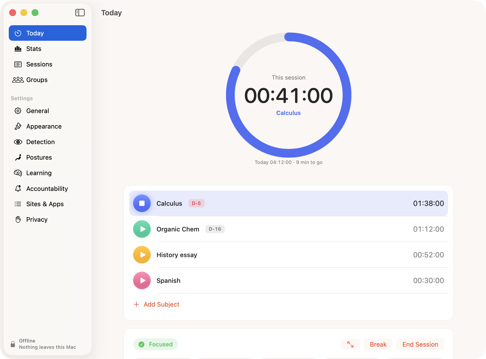
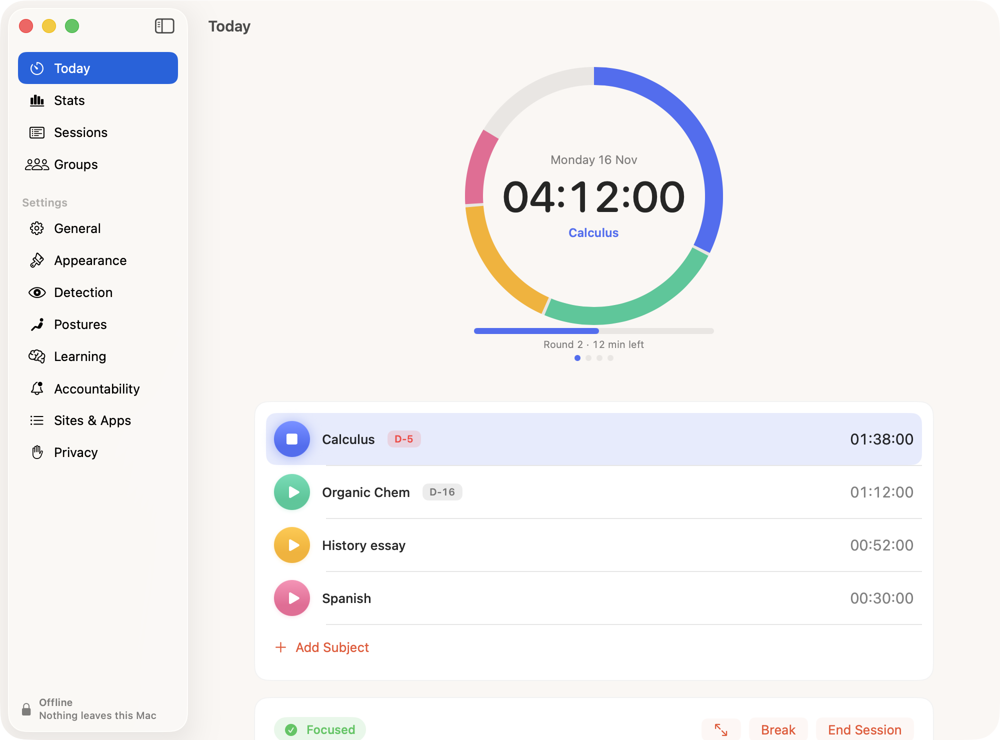
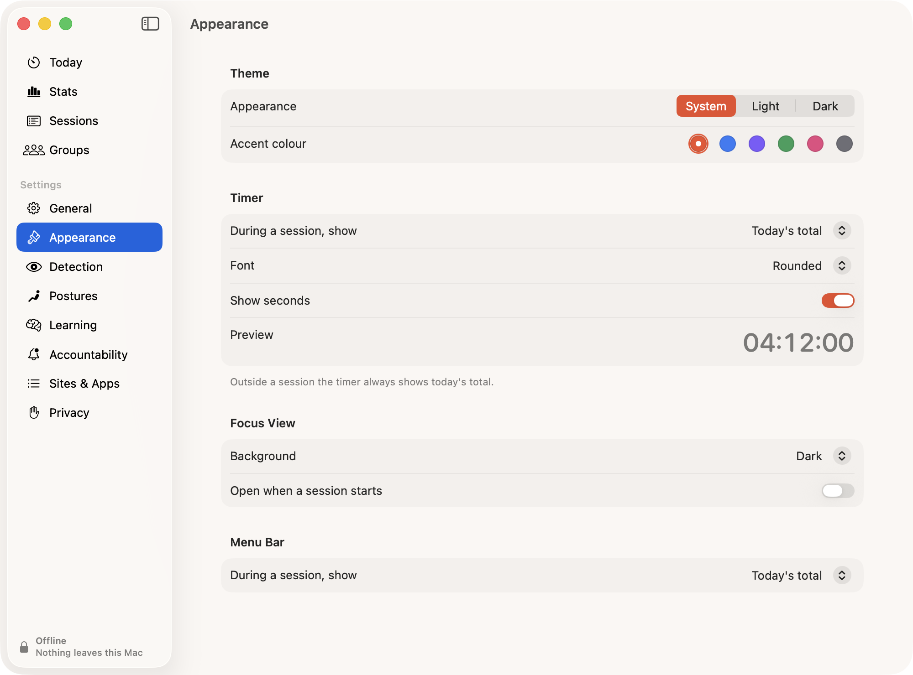
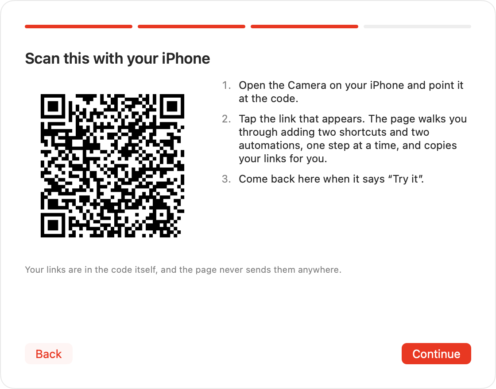
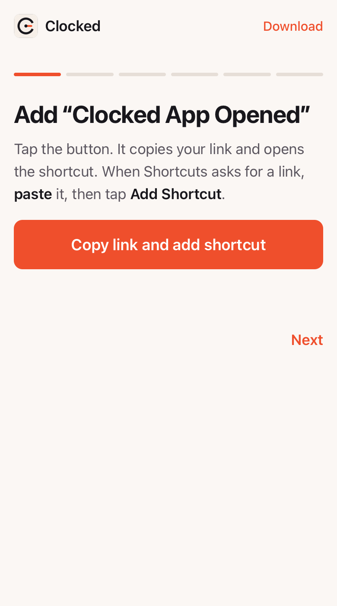

# How Clocked works

## Sessions

- Pick a subject and press play. The clock only counts while you're focused.
- Set a session goal (50 minutes by default). Time lost to distractions is added on.
- Shortcuts: ⌘1–⌘9 start a subject, ⌥⌘B break, ⇧⌘E end, ⌃⌘F full-screen timer.

## Timers

- During a session the big timer can show today's total, this session, or the time left in the session (Settings → Appearance). In session mode the ring fills towards your session goal, like YPT.
- Pomodoro mode (Settings → General → Timer): 25-minute rounds with breaks that start on their own, and a long break every 4 rounds. Only focused time counts towards a round, so distractions push the break back.
- Focus View can open by itself when a session starts.

  
  

## Customising

- Light, dark or system, and six accent colours.
- Timer font, with or without seconds.
- Focus View background: dark, black or the subject's colour.
- What sits next to the menu bar icon during a session.

## What it checks

- Camera: head and eye position compared with how you sit while typing, hands near your face, light on your face, and phones in view.
- Microphone: the type of sound, such as speech, music, typing or writing. Nothing is recorded.
- Keyboard and mouse: whether you're using them, not what you type.
- The app and browser tab in front. Apple Intelligence checks it against your subject.

## Phone detection

- Each cue adds to an evidence score every second. One cue on its own isn't enough.
- Looking down without typing is also what thinking looks like, so on its own it never gets past halfway.
- To flag you quickly it needs a sign of a phone as well: a phone in view, your taught phone posture, light from a phone on your face, phone-like sound, smiling down at your lap, or a message from the iPhone link.
- A hand on your face or looking around counts as thinking and pulls the score down.
- With no sign of a phone, it takes about 90 seconds of sitting still with your head down.
- At half the threshold, study time is held back. At the threshold, that time becomes phone time and the clock stops.
- Typing or looking back at the screen clears it.

## Strictness

| | Gentle | Firm | Strict |
|---|---|---|---|
| Banner | every 90 s | every 30 s | every 20 s |
| iMessage to your iPhone (optional) | every 2 min | every 45 s | every 30 s |
| Full-screen "Phone down" | never | after 45 s | after 15 s |
| Close the tab or hide the app | never | never | after 10 s |

Strictness can't be changed during a session.

## Correcting it

- Writing Notes on the banner pauses head-down checks for 25 minutes.
- Not My Phone counts that posture as screen time for the rest of the session.
- Teach Phone Detection (Settings → Learning) takes about 4 minutes and makes detection much faster and more accurate.
- A small neural network learns from all of this. See [neural-network.md](neural-network.md).

## iPhone link

- Your iPhone tells Clocked when you open or close the apps you pick, through two Shortcuts automations.
- Set it up in Settings → Accountability → iPhone. Clocked shows a QR code, and the page it opens on your phone walks you through it one step at a time.
- Optional: turn on a Study Focus during sessions, so the shortcuts only send while you study.
- Your iPhone and Mac need to be on the same Wi-Fi. Messages only count during a session.
- Messages go to a separate helper that only accepts connections from your local network with your pairing key. It can't use the camera, mic or your files, and nothing goes over the internet.

  
  

## Study groups

- Off until you turn them on.
- Friends join with an invite code, which is also the encryption key.
- You can add a profile photo by clicking your avatar in Groups. Sharing it is optional, and it's encrypted like everything else.
- Syncing runs in its own helper that can't use the camera or mic.

## Privacy

- The camera, mic and tab checks only run during a session.
- The main app has no network permission. Check with `codesign -d --entitlements - /Applications/Clocked.app`.
- Two optional helpers inside the app have network access: one sends encrypted study group totals, the other receives iPhone link messages on your Wi-Fi. Neither can use the camera or mic.
- Saved on your Mac: settings, daily totals, postures, the last 30 sessions, the learning examples and your profile photo if you add one.
- Settings → Privacy → Delete All My Data removes everything.

## Known limits

- Scrolling with the sound off in a bright room, with no taught phone posture, takes about 90 seconds to catch. Teach Phone Detection or the iPhone link fixes that.
- Reading a paper book without writing can look like phone use after a while. Turn on Working on paper (⌥⌘P).
- Firefox doesn't share its tabs, so only the app name is checked.
