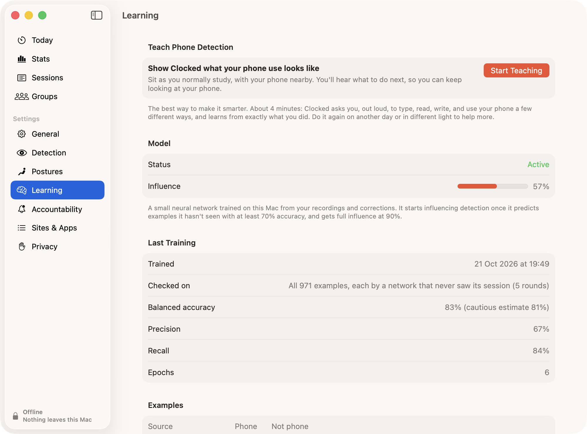

# The neural network

Phone detection uses hand-written rules: head down, no typing, sound not from the Mac. Everyone sits differently, so I added a small neural network that learns from your own sessions. It trains and runs on your Mac.

## What it is

- 32 inputs → 16 → 8 → 1 output, 673 weights in total.
- Every second it gets 32 numbers: head and eye position compared with your normal posture, typing and mouse activity, the type of sound, and whether a phone is visible. No images, audio or text.
- The output is the chance you're on your phone.
- Written by hand in Swift in `Sources/Clocked/PhoneNet.swift`.

## Training data

- Posture recordings (screen, paper, phone).
- Not My Phone and Writing Notes on a banner.
- Typing after a phone banner, which confirms it.
- Typing while facing the screen.
- Teach Phone Detection on the Learning page, a 4-minute guided session.

It retrains after every 40 new examples and at the end of each session.

## How much it's trusted

- It's scored on sessions it wasn't trained on.
- Below 70% accuracy it has no effect. It has full effect at 90%.
- It can push the evidence up or down, but it can't trigger a banner on its own.

## What I learned

On my first day of data it mostly learned "not typing = phone" and scored 66–71% on new sessions. More varied examples fixed that, so I added Teach Phone Detection.

## Storage

- Up to 1,500 examples (about 200 KB) and the model (about 20 KB).
- Reset Learning on the Learning page deletes both.

## Tests

`Tests/run.sh` checks the gradients, repeatability, and a simulated student over 8 sessions with some wrong labels.
